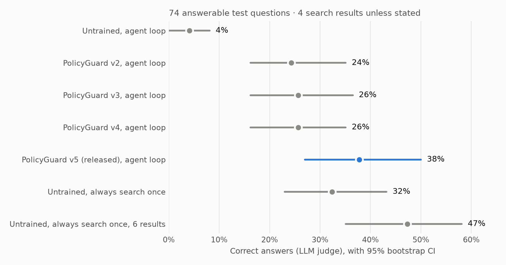

# PolicyGuard

PolicyGuard is a LoRA fine-tune of [Tiny Aya Global](https://huggingface.co/CohereLabs/tiny-aya-global) (3.35B) that answers questions about Indian health-insurance rules by searching IRDAI circulars. It cites the passages it used, and when the documents don't cover a question it is supposed to say so rather than guess.

I built it for the [Lexsi AI Safety & Alignment Hackathon](https://hackathon.lexsi.ai/), Track 3, problem statement 4 (fine-tuning for RAG). The synthetic data and self-distillation parts also overlap with problem statements 5 and 3. This README is also the project write-up.

Links:
- Demo: [huggingface.co/spaces/bhavyananda17/policyguard-demo](https://huggingface.co/spaces/bhavyananda17/policyguard-demo) (all 95 test questions side by side, with grades and search steps)
- Adapter: [bhavyananda17/policyguard-tiny-aya-global-lora](https://huggingface.co/bhavyananda17/policyguard-tiny-aya-global-lora) (PEFT and MLX)
- Dataset: [bhavyananda17/policyguard-irdai-qa](https://huggingface.co/datasets/bhavyananda17/policyguard-irdai-qa)
- Collections: [models](https://huggingface.co/collections/bhavyananda17/policyguard-lexsi-hackathon-6af8a31e037f3d7eaf41b4b4), [datasets and traces](https://huggingface.co/collections/bhavyananda17/policyguard-datasets-and-traces-6afadc16b254dced2f3f33a9) (evaluation transcripts, judge verdicts and logs are in the dataset repo under `eval/` and `logs/`)

## Why this problem

IRDAI rules change through circulars, and a newer circular can replace an older one. The May 2024 Master Circular replaced the 2020 standardization circular and changed several numbers along the way: the moratorium period went from 8 years to 60 months, the pre-existing-disease waiting period from 48 to 36 months, and the cancellation notice from 15 to 7 days. A model that reads the old circular gives a confident wrong answer, and a model that doesn't search at all just makes something up.

The untrained Tiny Aya does the second. Asked how often the Master Circular is reviewed, it answers without searching and cites a chunk it never saw:

> Untrained: The Master Circular is reviewed biennially or as required to ensure alignment with IRDAI's evolving regulations. [chunk 12]
>
> PolicyGuard: *(searches "How often will this Master Circular be reviewed?")* The Master Circular is reviewed every year unless review or repeal is warranted earlier. [chunk 1]

Small models are the ones that would realistically run on a phone or behind a support line, so I wanted to see whether a small fine-tune could get a 3B model to behave like a careful search agent rather than a confident guesser.

## Results

The test set has 95 scored questions that share no source passage with the training data: 60 single-rule, 6 two-rule, 8 about a replaced rule, and 21 that the documents don't answer. Three broken items are excluded (see [Evaluation](#evaluation)). Every setup uses the same base model, search index and greedy decoding. Correctness is graded by an LLM judge (qwen3.8-27b) on the 74 answerable questions.

| Setup | Correct (95% CI) | Correct or partly | Wrongly says "not found" | Cites the right passage | "Not found" P / R / F1 |
|---|---|---|---|---|---|
| Untrained, no search | – | – | 5% | 0% | 0.50 / 0.19 / 0.28 |
| Untrained, agent loop | 4% (0–8) | 24% | 14% | 3% | 0.29 / 0.19 / 0.23 |
| PolicyGuard v4, agent loop | 26% (16–35) | 49% | 3% | 42% | 0.78 / 0.33 / 0.47 |
| PolicyGuard v5, agent loop (released) | 38% (27–50) | 53% | 1% | 45% | 0.80 / 0.19 / 0.31 |
| Untrained, always search once | 32% (23–43) | 54% | 11% | 30% | 0.56 / 0.48 / 0.51 |
| Untrained, always search once, 6 results | 47% (35–58) | 58% | 7% | 43% | 0.62 / 0.38 / 0.47 |

All rows use the top 4 search results except the last.



In the same agent loop, fine-tuning takes the model from 4% to 38% correct. The untrained model searches on about 10% of questions and invents citations; the tuned one searches every time and tries a different query when the first one misses.

It does not clearly beat the simplest alternative, which is to always search once with the question and let the untrained model answer from the results. At 4 results v5 is 6 points ahead, but the paired 95% CI on that difference is −7 to +18. With 6 results that simple pipeline reaches 47%, which is the best number I measured. PolicyGuard's advantages are elsewhere: it cites the right passage more often, it almost never refuses a question it could answer, and its "not found" answers are usually right. The flip side is that v5 only catches 4 of the 21 questions the documents don't answer.

I can't say anything about whether it prefers the current rule over the replaced one. There are only 8 replaced-rule test questions, from about two topics, and every setup used the old rule on 25–50% of them.

Accuracy is low across the board. Search only finds the source passage for 71% of answerable questions at 4 results (81% at 6), and a 3B model reading regulatory text often drops a condition or a date.

### Second judge

To check that the results aren't an artifact of one judge, I re-graded three setups with gpt-oss-120b ([src/judge_agreement.py](src/judge_agreement.py), output in `results/judge2/`).

| Setup | Correct (qwen3.8-27b) | Correct (gpt-oss-120b) | Exact agreement | Cohen's κ |
|---|---|---|---|---|
| Untrained, agent loop | 4% | 12% | 84% | 0.73 |
| PolicyGuard v4, agent loop | 26% | 34% | 80% | 0.69 |
| Untrained, always search once | 32% | 43% | 76% | 0.65 |

Across all 222 verdicts they agree 80% of the time (κ = 0.70). gpt-oss-120b is more lenient, mostly by upgrading "partial" to "correct", but it ranks the setups the same way. v5 was only graded by qwen3.8-27b.

### Agent metrics by question type

Task success counts an answerable question as solved when the judge grades it correct, and an unanswerable one when the model says "not found". "Search found the answer" is the share of answerable questions where at least one search returned a passage containing the answer. Latency is wall-clock time per question with MLX on an M5 Pro. Every transcript parsed cleanly: there were no malformed tool calls in any run. Computed by [src/agent_metrics.py](src/agent_metrics.py); the numbers are in `results/agent_metrics.json`.

| Task success | Single-rule (60) | Two-rule (6) | Replaced rule (8) | Not answered (21) | All (95) |
|---|---|---|---|---|---|
| Untrained, agent loop | 5% | 0% | 0% | 19% | 7% |
| Untrained, always search once | 33% | 0% | 50% | 48% | 36% |
| Untrained, always search once, 6 results | 53% | 17% | 25% | 38% | 45% |
| PolicyGuard v4 | 27% | 17% | 25% | 33% | 27% |
| PolicyGuard v5 | 45% | 0% | 13% | 19% | 34% |

| Tool use and latency (all 95) | Searches per question | Search found the answer | Seconds per question |
|---|---|---|---|
| Untrained, agent loop | 0.11 | 5% | 3.8 |
| Untrained, always search once | 1.00 | 80% | 3.3 |
| Untrained, always search once, 6 results | 1.00 | 84% | 3.5 |
| PolicyGuard v4 | 1.07 | 81% | 3.3 |
| PolicyGuard v5 | 1.21 | 77% | 3.6 |

The gains from v5 are almost all on single-rule questions. The two-rule and replaced-rule groups are too small to read much into. v5's searches find the answer slightly less often than v4's, probably because of the keyword queries. Extra searches cost about a second each, so the agent is only marginally slower than the fixed pipeline.

### Training rounds

| Version | What changed | Correct | Wrongly says "not found" | "Not found" F1 |
|---|---|---|---|---|
| v1 | Teacher answers, 28% "not found" examples | not judged | 26% | 0.57 |
| v2 | 18% "not found", 60 "search again" examples | 24% | 18% | 0.55 |
| v3 | Answer passage sometimes placed last, near-miss "not found" examples, 3 epochs | 26% | 0% | 0.50 |
| v4 | 79 final answers self-distilled from the untrained model's always-search answers | 26% | 3% | 0.47 |
| v5 | 6 results per search, keyword first queries, longer distilled answers | 38% | 1% | 0.31 |

The thing that moved most between v1 and v4 was the balance between answering and refusing, and it was set almost entirely by the "not found" examples. v1 saw one fixed refusal sentence many times and learned to use it as an easy way out, refusing 26% of answerable questions. Varying the wording and adding near-miss examples (results on the right topic that don't contain the answer) fixed that, but v3 and later catch fewer of the genuinely unanswerable questions.

Accuracy didn't move from v2 to v4. Self-distillation in v4 nudged correct-or-partly-correct from 45% to 49% and word overlap from 0.46 to 0.52, both within noise. What finally moved accuracy was rerunning v4 and the always-search pipeline with 6 results instead of 4, without retraining. The pipeline went from 32% to 47% and its right-passage citations from 30% to 43%. v4 only went from 26% to 30%, and its citations dropped from 42% to 35%. v4 had only ever seen 4-result observations. For v5 I rebuilt the training data ([scripts/round5b.sh](scripts/round5b.sh)) with:
- 6 results per observation;
- a short keyword query as the first search in about 40% of trajectories, instead of the question copied verbatim;
- self-distilled answers taken from the 6-result pipeline, allowed up to 150 words.

Everything else stayed the same as v4. On the same 74 questions v5 gets 12 right that v4 missed and misses 3 that v4 got, a gain of 12 points (paired 95% CI +3 to +23). Two things didn't go as expected. v5 does a bit worse when actually given 6 results (32%) than 4 (38%), although that's within noise. It also still copies the question as its first query 82 times out of 98, so the keyword-query change only partly worked.

v5 is the adapter on Hugging Face. v4 is still in that repo's commit history.

## How it works

```
IRDAI PDFs (2024 current + 2020 replaced)
   │  build_index.py: page-wise cleaning, ~140-word chunks, hybrid search
   ▼                  (MiniLM dense + TF-IDF, reciprocal rank fusion)
search index (495 chunks)
   │  gen_questions.py: questions + answers written from passages on Groq
   ▼                    (gpt-oss-120b, gpt-oss-20b, qwen3.8-27b); key facts must appear verbatim
377 questions → 335 after dedupe
   │  build_dataset.py: train/test split with no shared passages; trajectories built from
   ▼                    real searches of the index (items whose source isn't retrieved are dropped)
trajectories (+ retry, buried-answer and near-miss variants)
   │  distill_answers.py: swap in the untrained model's own answers where they pass filters
   ▼
MLX LoRA (rank 16, q/k/v/o in the top 16 layers, 3.4M params, 3 epochs)
   │
   ▼
run_agent.py → score.py (deterministic metrics) + judge.py (LLM judge)
```

Tiny Aya's chat template has no tool role, so the agent uses a plain-text ReAct format. The model writes `Thought: …` and then either `Action: search_docs("…")` or `Final Answer: … [chunk N]`. Search results come back as a user turn starting with `Observation:`. Each result shows the document title, date and page but not whether that document is still in force, so the model has to work that out from the dates. It gets at most 3 searches per question. Here is a real transcript for the review question above, with the results shortened:

```
Thought: I need to check what the IRDAI documents say about this.
Action: search_docs("How often will this Master Circular be reviewed?")

Observation:
[chunk 0] IRDAI Master Circular on Health Insurance Business (29 May 2024) | page 1
... B. The Master Circular shall be reviewed every year unless review or repeal is warranted earlier. ...
[chunk 1] IRDAI Master Circular on Health Insurance Business (29 May 2024) | page 2 ...

Thought: The results answer the question.
Final Answer: The Master Circular is reviewed every year unless review or repeal is warranted earlier. [chunk 1]
```

The answer is right, but the sentence is in chunk 0 and the model cites chunk 1. Picking the wrong one of two adjacent chunks is a common slip at this size. That's why citation is measured separately from correctness, and why `cites_answer` also accepts a neighbouring chunk that contains the fact.

### Data

The questions were written from the passages by models on Groq:

| Kind | Meaning | Written by |
|---|---|---|
| Single-rule | answered by one current passage | gpt-oss-20b |
| Two-rule | needs two passages | gpt-oss-20b |
| Replaced-rule | the 2024 rule differs from the 2020 rule | gpt-oss-120b |
| Not answered | the documents don't answer it | qwen3.8-27b, then checked by retrieval plus an LLM |

A question was kept only if its key facts appear verbatim in its source passage, and near-duplicates (MiniLM cosine above 0.9) were dropped. That left 335 of 377. For the split, items that share a passage, or share a replaced 2020 passage, are kept on the same side, so train and test never share a source.

In the training data, the search steps are real calls to the index, built by code rather than imagined by a teacher, so the model trains on the same imperfect results it sees at test time. The final answers come from teacher models (gpt-oss on Groq), or, from v4 on, partly from the untrained Tiny Aya's own answers to the same search results. Loss is on assistant turns only (search decisions, queries and answers), never on the question or the retrieved text.

The self-distilled answers replace a teacher answer only when all of these hold:
- the same chunks were retrieved;
- the answer overlaps the reference well and hits a key fact;
- it cites only chunks that were shown;
- for replaced-rule items, it doesn't use the old rule;
- it stays under the length cap (120 words in v4, 150 in v5).

The idea is that answers in the model's own style are easier for it to learn than a much larger teacher's. 79 answers passed in v4 and 49 in v5.

| | Train | Test (scored) |
|---|---|---|
| Single-rule | 132 | 60 |
| Two-rule | 19 | 6 |
| Replaced-rule | 23 | 8 |
| Not answered by the documents | 63 | 21 |

The 237 training questions produce about 375 trajectories, including 60 "search again", 60 "answer is in the last result" and 25 near-miss "not found" variants. After holding out 18 for validation and capping "not found" at 20%, v5 trains on 341 trajectories (778 per-turn examples).

Training settings (v5):
- LoRA rank 16 with alpha 32 and dropout 0.05, on the q/k/v/o attention projections of layers 20–35. That is 3.4M trainable parameters, 0.10% of the model.
- Adam with learning rate 1e-4, batch 2, 3 epochs (1,167 steps), max length 4,608 tokens.
- MLX 0.32.2 (`mlx-lm`); the config is `configs/lora_v5.yaml`.

The released adapter is also converted to PEFT format for `transformers` ([src/export_peft.py](src/export_peft.py)). On 10 checked agent turns it reproduces the MLX greedy output on 8. The other 2 split where the top two tokens are within 0.12 logits, which is a numeric-precision difference rather than a conversion error.

## Evaluation

There are four setups:
- `no_tools`: the question only;
- `naive_rag`: always search the question once and answer from the top results;
- `agent`: the model decides when to search;
- `agent_force`: the model must search before answering.

For the tuned models `agent` and `agent_force` behave identically, because they always search.

[src/score.py](src/score.py) computes the deterministic metrics, with 95% bootstrap CIs written to `results/summary.json`:
- word overlap with the reference answer and key-fact recall;
- the wrong "not found" rate, and "not found" precision/recall/F1 on the 21 unanswerable questions;
- old-rule use (numbers that only appear in the replaced rule) and searches per question;
- whether the cited chunk is the source passage. Chunks overlap, so `cites_answer` also accepts a chunk that contains the key fact.

[src/judge.py](src/judge.py) asks `qwen/qwen3.8-27b` to grade each answer as correct, partial or wrong against the reference and its key facts. Refusals are graded without an LLM call. Every call is cached in `data/cache/`, so the numbers reproduce offline.

Three test questions come from blank policy templates where the "answer" is literally "XXX". They're excluded from every score ([data/qa/test_exclusions.json](data/qa/test_exclusions.json)).

I made two measurement mistakes along the way, and both changed the conclusions:
- My first headline metric was word overlap, which rewards long answers that copy the passage. That's why I added the judge.
- My first "not found" detector missed phrasings like "not explicitly stated", which the untrained model uses a lot. That undercounted the always-search pipeline's refusals and made PolicyGuard look much better at spotting unanswerable questions than it is. Fixing it raised the pipeline's "not found" F1 from 0.22 to 0.51. Every number above uses the fixed detector.

## Reproduce

You need an Apple Silicon Mac (training and inference use MLX) and Python 3.12. You also need a Hugging Face token with access to the gated `CohereLabs/tiny-aya-global`. A Groq API key is only needed to regenerate questions or re-run the judge without the cache. I used a 24 GB M5 Pro, where one training run takes about an hour.

```bash
git clone https://github.com/bhavyananda17/lexsi_labs_project && cd lexsi_labs_project
uv venv -p 3.12 && source .venv/bin/activate
uv pip install -r requirements.txt
cp .env.example .env        # add HF_TOKEN, and GROQ_API_KEY if needed
export $(grep -v '^#' .env | xargs)
```

Download the three circulars from irdai.gov.in into `data/raw/`:

| File | Document |
|---|---|
| `current_mc_health_2024.pdf` | Master Circular on Health Insurance Business, 29 May 2024 ([source](https://irdai.gov.in/document-detail?documentId=4942918)) |
| `current_mc_health_2024_annexure.pdf` | Annexure to the same circular (same page) |
| `superseded_mc_standardization_2020.pdf` | Master Circular on Standardization of Health Insurance Products, 22 July 2020 ([source](https://irdai.gov.in/document-detail?documentId=395035)) |

Then run the pipeline:

```bash
python src/build_index.py                       # search index (data/index/, also committed)
python src/gen_questions.py                     # optional: questions are committed, Groq replies are cached
python src/build_dataset.py                     # split + trajectories -> data/sft/train.jsonl
for m in no_tools naive_rag agent agent_force; do python src/run_agent.py --mode $m; done
bash scripts/round5b.sh                         # v5: distillation, training data, training, evaluation, judging
```

The earlier rounds are `scripts/overnight.sh` (data, baselines, v1), then `round2.sh` to `round5.sh`. Logs are in `logs/`, and every run's answers and transcripts are in `results/`.

To ask a single question and see the full search transcript:

```bash
python src/ask.py "What is the moratorium period for a health insurance policy?"
python src/ask.py --adapter none "..."          # untrained model, for comparison
```

`python demo/app.py` runs a local Gradio version of the demo, with a live mode that takes about a minute per question. The hosted demo is a static page (`demo_static/`) showing the pre-run results, because free Gradio Spaces now need a paid plan.

## Repository layout

```
src/
  build_index.py      PDF -> chunks -> FAISS + TF-IDF hybrid index
  search.py           the search_docs tool
  llm.py              Groq client with disk cache and rate-limit handling
  gen_questions.py    synthetic questions (single-rule, two-rule, replaced-rule, not answered)
  build_dataset.py    validation, leak-free split, trajectories and variants
  distill_answers.py  self-distilled final answers
  make_mlx_data.py    per-turn MLX training files, "not found" cap
  agent.py            system prompt and ReAct parser
  run_agent.py        evaluation harness
  score.py, judge.py  deterministic metrics, LLM judge
  ask.py              ask one question
configs/              MLX LoRA configs per round
data/qa/              questions, split, exclusions, generation report
data/sft/, data/mlx*  trajectories and training files
results/              every run's answers and transcripts, summaries, judge verdicts
```

## Limitations

- **Small test set.** With 74 answerable and 21 unanswerable questions, differences of a few points are noise. With only 8 replaced-rule questions, the question I most wanted to answer (does the model follow the newer rule?) isn't answered.
- **Synthetic questions.** LLMs wrote the questions from the passages, so they lean on the circulars' own wording. The "not answered" questions were checked by retrieval plus an LLM, not by a person.
- **Judges, not people.** Two LLM judges agree reasonably well (κ = 0.70), but I didn't collect human labels.
- **Near-miss examples.** These are built by removing passages that contain a key fact verbatim, so a remaining passage could still state the answer in other words.
- **Search is the ceiling.** It finds the source passage for 71% of answerable questions, and 52 of the 495 chunks are longer than MiniLM's 256-token window.
- **Not advice.** This is not legal or financial advice. It covers two IRDAI documents, and real policies and later circulars may differ.

## What I'd try next

- More keyword-query trajectories, so the agent's searches actually differ from the fixed pipeline's, and a reranker, which would help every setup.
- Near-miss "not found" examples written at 6 results, to win back the unanswerable questions v5 gave up.
- Hand-checked replaced-rule questions across more topics, so the current-versus-old-rule question can be measured.
- Training on the agent's own successful runs (rejection sampling) instead of only teacher-shaped trajectories.

## Notes on tools and data

I wrote the code and docs with Claude (Anthropic) as a coding assistant; I reviewed the design, experiments and results. Questions, reference answers and key facts were generated with `openai/gpt-oss-120b`, `openai/gpt-oss-20b` and `qwen/qwen3.8-27b` on Groq, and every request and response is in `data/cache/`. The source documents are public IRDAI circulars; IRDAI is not affiliated with this project.

## License

The code is MIT. The adapter is a derivative of Tiny Aya Global and follows its CC-BY-NC-4.0 license (non-commercial). The dataset is CC-BY-NC-4.0.
